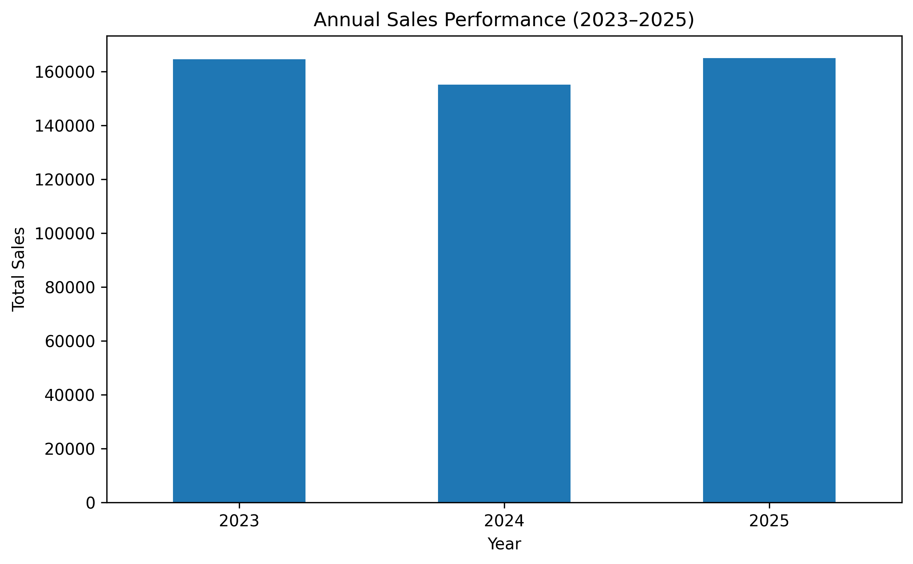

# E-commerce Sales Analysis with Python

## Project Overview

This project analyzes an e-commerce dataset containing 2,000 orders, 40 unique products, and 4 product categories, covering January 2023 to December 2025.

The objective is to explore sales performance, profitability, customer segments, payment methods, geographic differences, and the relationship between discounts and profit margins.

## Tools and Technologies

- Python
- Pandas
- Matplotlib
- Google Colab

## Key Findings

- **Overall performance:** Total sales were 484,559.34 and total profit was 158,872.32.
- **Annual trends:** Sales declined in 2024 before recovering in 2025. Sales in 2025 reached 164,965.16.
- **Product categories:** Furniture generated the highest sales, while Office Supplies had the lowest profit margin at 17.12%.
- **Customer segments:** Consumer generated the highest total sales and profit.
- **Discounts:** Overall profit margins declined as discount levels increased, from 38.72% at a 0% discount to 13.42% at a 30% discount.
- **Loss-making orders:** 272 orders (13.6%) had negative profit.
- **Product-level findings:** Paper Clips Box 500pc recorded a total loss of 79.95 across 45 orders.

## Data Quality Checks

The analysis included checks for missing values, duplicate rows, duplicate order IDs, category consistency, and discrepancies between recorded and recalculated sales.

No missing values or duplicate rows were identified. Some orders showed a difference of 0.01 between recorded and recalculated sales, consistent with rounding differences.

## Conclusion

The analysis identified differences in sales performance and profitability across years, product categories, customer segments, and discount levels.

Office Supplies and products with negative profit are potential areas for further investigation. The relationship between discounts and profitability also deserves attention.

These findings describe patterns in the dataset and do not establish that discounts directly cause lower profit margins.

## Project Structure

- `ecommerce-sales-data-analysis.ipynb` — Jupyter notebook containing the analysis, calculations, and results.
- `README.md` — Project overview, key findings, and conclusion.

## Visualizations

### Annual Sales Performance (2023–2025)

